# Lab Active Directory sur Windows Server 2022

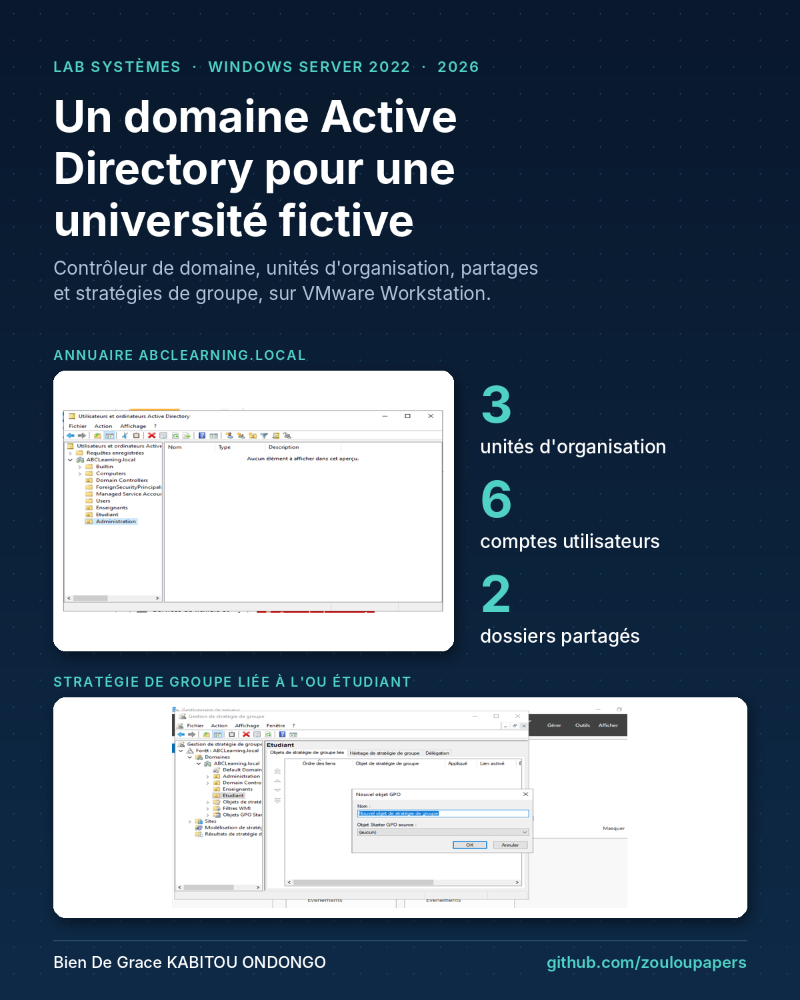

> **EN**: Lab built on VMware Workstation with a Windows Server 2022 domain controller (`ABCLearning.local`) and a Windows 10 client. It covers organizational units, domain user accounts, shared folders with role-based permissions and Group Policy Objects for a fictional university.

Projet réalisé dans le cadre du module Administration Windows (L2 Ingénierie des réseaux et systèmes, Université Centrale, Tunis), avril 2026.

## Contexte

ABCLearning est un établissement universitaire fictif. Ses utilisateurs se répartissent en trois catégories : enseignants, étudiants et administration. L'objectif est de centraliser la gestion des comptes et de contrôler l'accès aux ressources grâce à un domaine Active Directory.

## Environnement

| Machine | Système | Rôle | Adresse IPv4 |
|---|---|---|---|
| ABCLearningDC | Windows Server 2022 | Contrôleur de domaine (AD DS, DNS) | 192.168.198.10/24 (statique) |
| ABCLearningUser | Windows 10 | Poste client | Attribuée par DHCP (192.168.198.130 lors du test) |

Hyperviseur : VMware Workstation Pro 17, réseau `192.168.198.0/24`.

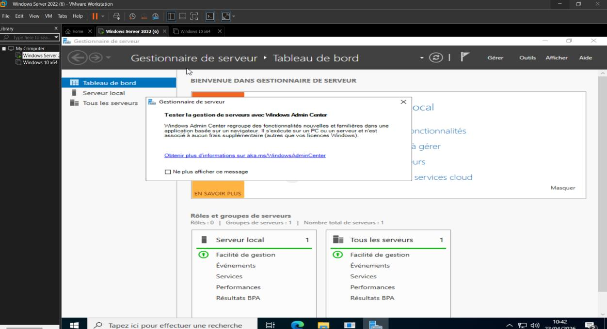

## Étapes réalisées

1. **Préparation des machines** : renommage des VM (ABCLearningDC, ABCLearningUser), fuseau horaire, mises à jour Windows.
2. **Adressage** : adresse IP statique pour le serveur, puis test de connectivité depuis le client (`ping 192.168.198.10` : 4 paquets reçus, 0 % de perte).
3. **Installation du rôle AD DS** et promotion du serveur en contrôleur de domaine : domaine `ABCLearning.local`, nom NetBIOS `ABCLEARNING`, DNS intégré.
4. **Structure de l'annuaire** : unités d'organisation *Enseignants*, *Etudiant* et *Administration*.
5. **Comptes utilisateurs** : 6 comptes créés dans leur OU (2 enseignants, 2 étudiantes, 2 administrateurs).
6. **Dossiers partagés** avec des droits selon le rôle (tableau ci-dessous).
7. **Stratégies de groupe (GPO)** :
   - `GPO_Interdiction_Installation_Etudiants`, liée à l'OU *Etudiant* : paramètre *Désactiver Windows Installer* (Configuration ordinateur > Modèles d'administration > Composants Windows > Windows Installer) ;
   - interdiction de l'accès au Panneau de configuration pour les étudiants et les enseignants ;
   - désactivation des ports USB pour les étudiants et les enseignants.

### Droits sur les dossiers partagés

| Dossier | Enseignants | Étudiants | Administration |
|---|---|---|---|
| Supports du cours | Lecture et écriture | Lecture seule | — |
| Documents administratifs pour enseignants | Lecture seule | — | Lecture et écriture |

## Captures

| Test de connectivité client → serveur | Nom NetBIOS du domaine |
|---|---|
| 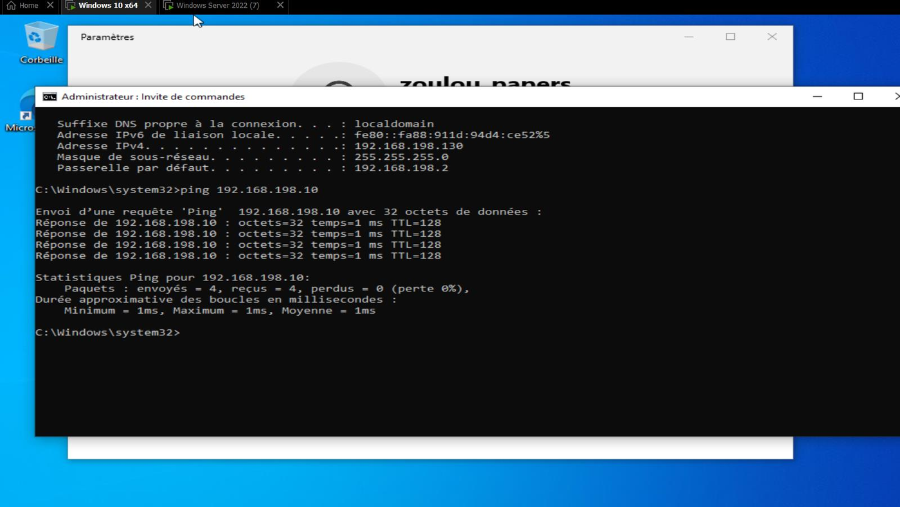 | 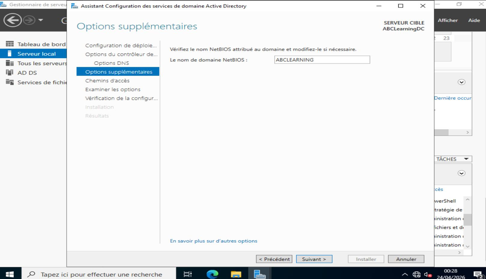 |

| Ouverture de session sur le domaine | Rôles AD DS et DNS installés |
|---|---|
| 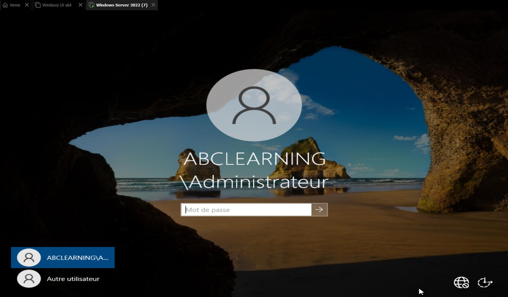 | 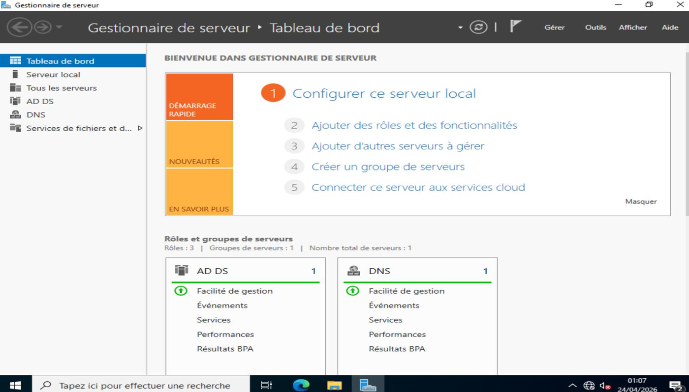 |

| Unités d'organisation | Comptes de l'OU Enseignants |
|---|---|
| 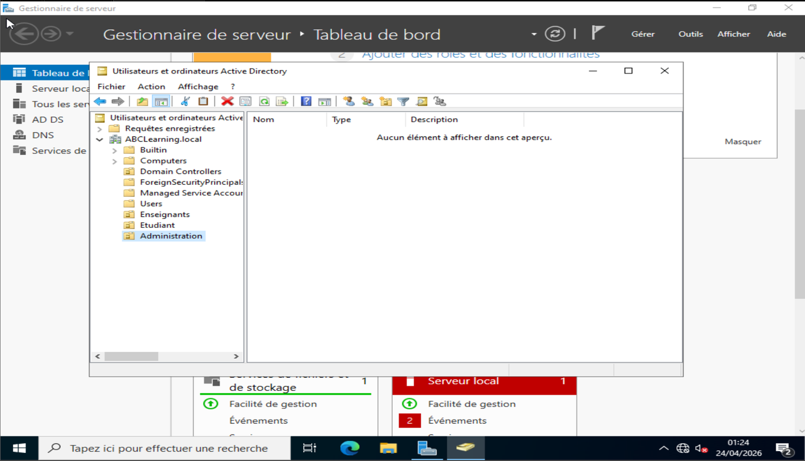 | 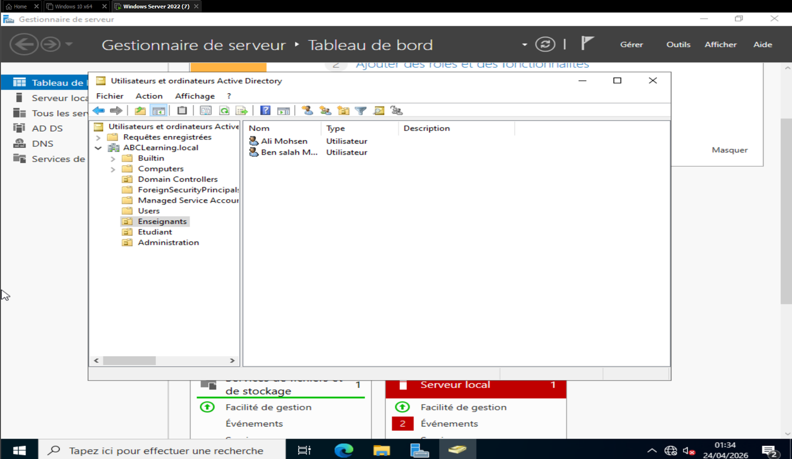 |

| Partage « Supports du cours » | Partage « Documents administratifs » |
|---|---|
| 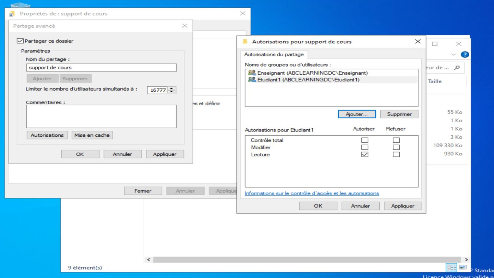 | 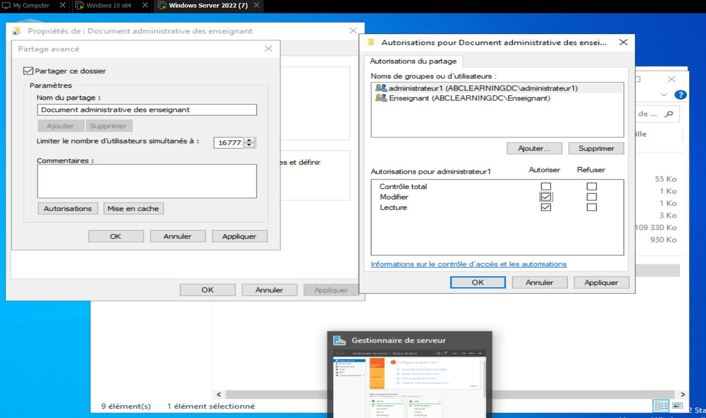 |

| Partages visibles depuis le client | Création de la GPO sur l'OU Etudiant |
|---|---|
| 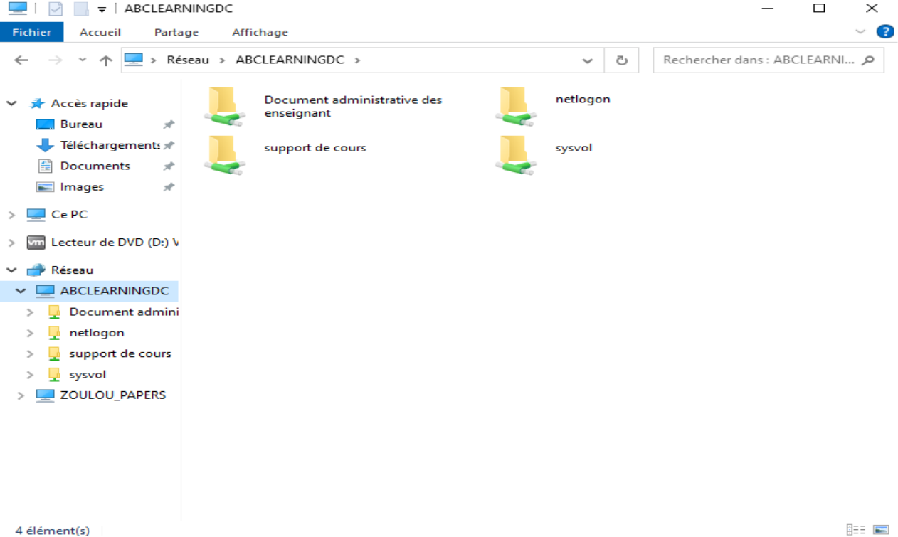 | 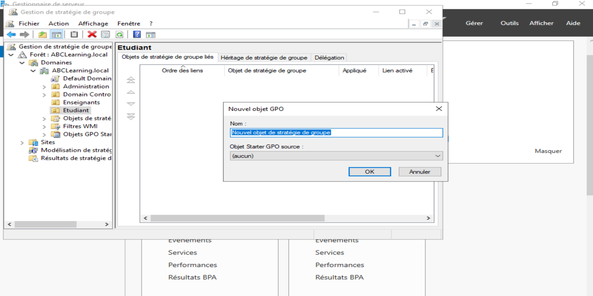 |

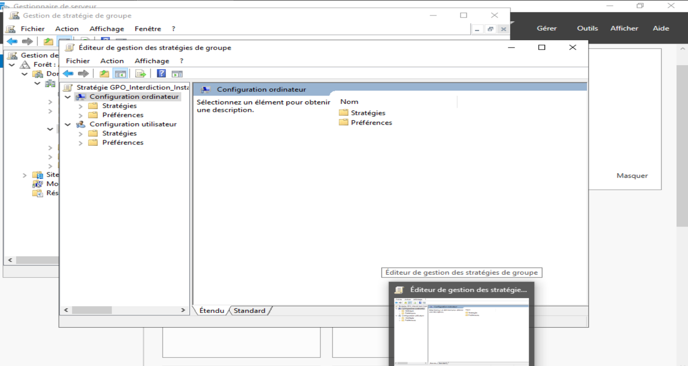

## Pistes d'amélioration

- Les paramètres de la partie *Configuration ordinateur* d'une GPO ne s'appliquent qu'aux **ordinateurs** placés dans l'OU liée. Pour cibler les comptes étudiants, il faut utiliser la partie *Configuration utilisateur* (par exemple *Interdire l'accès au Panneau de configuration*) ou placer les postes étudiants dans leur propre OU.
- Joindre le poste Windows 10 au domaine, puis vérifier l'application des GPO avec `gpupdate /force` et `gpresult /r`.
- Attribuer les droits de partage et NTFS à des **groupes de sécurité** du domaine (méthode AGDLP) plutôt qu'à des comptes individuels.

## Compétences mobilisées

Windows Server 2022 · Active Directory (AD DS) · DNS · unités d'organisation · comptes et groupes · partages et autorisations · stratégies de groupe (GPO) · VMware Workstation

## Auteur

**KABITOU ONDONGO Bien De Grace**, étudiant en L3 Ingénierie des réseaux et systèmes. Voir [github.com/zouloupapers](https://github.com/zouloupapers).
